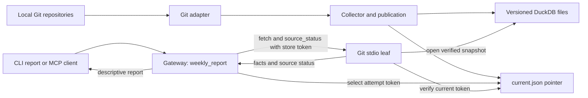

# Architecture

The implemented path collects local Git history into daily facts, publishes a
versioned DuckDB snapshot, and builds a descriptive report through a gateway and
an internal stdio leaf. Git is the only adapter registered in
[`mesh_config.py`](../tools/mesh_config.py).

## Collection and provenance

[`git_source.py`](../tools/git_source.py) checks that every configured repository
has full local history, captures its HEAD object ID, and reads commits reachable
from those captured IDs. It excludes merges, matches exact author emails,
deduplicates commit object IDs across repositories, and assigns author timestamps
to civil dates in the configured analysis timezone. A concurrent HEAD movement
after capture does not expand the selected history.

The recorded measurement definition includes the email allowlist, canonical
repository paths, ref scope, merge policy, deduplication rule, timestamp rule,
timezone, and normalization version. Its digest identifies what each value means.
Collection provenance records captured HEADs, history-completeness checks, the
requested date window, and a snapshot ID derived from the captured HEAD map.

[`collector.py`](../tools/collector.py) stores observations and collection
attempts separately. A fully observed day without qualifying commits receives a
zero. If one configured repository is unreadable or incomplete, the Git metric
fails for that run: prior facts survive, the failure is recorded, and a partial
repository subtotal does not masquerade as complete data. Source status can
therefore distinguish retained facts from the outcome of the latest attempt.

The active measurement definition is checked before sync and report. Changing it
requires a new store or restoration of the previous configuration; rederiving
existing history under a new definition is outside this milestone. Report-only
freshness and descriptive threshold settings are separate from measurement
identity.

## Snapshot publication and reads

[`store.py`](../tools/store.py) writes each generation to a distinct path shaped
like `facts.<store_instance_id>.<generation>.duckdb`. Publication builds and
validates a new generation, then replaces `current.json` atomically. The pair
`(store_instance_id, generation)` is the store token: a generation number alone
cannot distinguish an old store from a newly created one.

Distinct generation paths address DuckDB's database-instance caching by path.
Readers open the named snapshot read-only and verify its internal manifest.
Publication uses a local lifecycle lock and refuses nested publication. This is
a single-machine, single-writer design; it has no distributed locking or
authentication layer.

The collector reclaims old generation files after publication, retaining the
current generation and two predecessors. Files younger than a 300-second grace
window are also retained, so a burst of publications can temporarily leave more
files. This retention policy is not backup/restore, and the remaining APFS crash
verification gate has not passed.

## Gateway and leaf responsibilities

[`gateway_server.py`](../tools/gateway_server.py) exposes only `weekly_report`.
[`gateway.py`](../tools/gateway.py) starts the configured source leaves and
selects one token for each complete report attempt. It sends that token with
every internal `fetch` and `source_status` call and verifies the identity on
successful responses before using their contents.

[`stdio_leaf.py`](../tools/stdio_leaf.py) exposes only `fetch` and
`source_status`. Each call reads the pointer and opens a snapshot verified against
the supplied token. Both gateway and leaf read the pointer; the gateway owns
selection of the report attempt's token. The external client supplies no token.

If a publication advances the generation during a report, the gateway discards
that attempt and retries the whole fan-out, with a budget of two retries. A
different store instance is an error rather than a retry. Missing identity in a
successful leaf response is refused. This prevents assembling successful results
from different generations into one report.

`mesh report` uses the same gateway/leaf transport. Report assembly uses returned
facts and source status; the preliminary configuration-definition check reads
the store to verify that the requested measurement still matches.

## Descriptive calculations

[`report.py`](../tools/report.py) defines Monday–Sunday ISO weeks. The default
target is the last complete week before `as_of`. A weekly value is the arithmetic
mean over present daily facts, so a complete week's denominator is seven. Missing
dates are excluded; they are never filled with zeros by report arithmetic.

At least five present days make a week valid. The eight immediately preceding
weeks supply the baseline, which needs at least six valid weekly values. The
report computes the baseline median, dispersion `1.4826 × MAD`, the raw delta,
and the standardized delta when dispersion is nonzero.

`meaningful` requires both an absolute standardized delta of at least `1.0` and
the configured minimum absolute raw delta. Zero dispersion leaves the
standardized delta undefined and `meaningful=false`. An unset raw threshold also
prevents a meaningful flag. These are descriptive rules; calibration, inference,
associations, and recommendations remain disabled.

## Protocol and contract boundaries

[`mcp_stdio.py`](../tools/mcp_stdio.py) supplies the shared JSON-RPC dispatch,
input limits, and error handling. The implemented profile is stateless stdio,
pinned to `2026-07-28`, with the methods `server/discover`, `tools/list`, and
`tools/call`. Requests contain `io.modelcontextprotocol/protocolVersion` and
`io.modelcontextprotocol/clientCapabilities` in `params._meta`. The profile uses
no `initialize` handshake.

The vendored protocol schema has a commit pin and checksum in its
[provenance record](../schemas/mcp-official-2026-07-28.provenance.json).
[`validate_contracts.py`](../tools/validate_contracts.py) verifies the delivered
schemas and fixtures without regenerating them. Artifact-integrity tests verify
that tampering is detected; generation round-trip tests operate in scratch copies.

The contract and synthetic-fixture catalog is broader than the runtime. Files
for health, Screen Time, comparisons, or associations do not mean those source
adapters or public tools are implemented. The served tool lists above define the
runtime surface. Transport tests establish the tested profile, not universal MCP
client compatibility or implementation of the entire pinned schema.
